# Healthcare Admissions Analysis

An end-to-end analysis of a healthcare admissions dataset using Python, SQL and Power BI. This repository covers the Python stage: loading, cleaning, feature engineering, exploration and visualization. The cleaned output feeds the SQL analysis and the Power BI dashboard.

## Table of Contents

1. [Project Overview](#project-overview)
2. [Workflow](#workflow)
3. [Dataset](#dataset)
4. [Repository Structure](#repository-structure)
5. [Tools and Libraries](#tools-and-libraries)
6. [Step 1: Load the Data](#step-1-load-the-data)
7. [Step 2: Data Cleaning](#step-2-data-cleaning)
8. [Step 3: Feature Engineering](#step-3-feature-engineering)
9. [Step 4: Exploration](#step-4-exploration)
10. [Step 5: KPIs](#step-5-kpis)
11. [Step 6: Visualizations](#step-6-visualizations)
12. [Key Observations](#key-observations)
13. [Limitations and Data Quality Notes](#limitations-and-data-quality-notes)
14. [Next Steps: SQL and Power BI](#next-steps-sql-and-power-bi)
15. [How to Run](#how-to-run)

## Project Overview

The goal of this project is to take a raw healthcare dataset, prepare it properly, and present the findings in a way that other people can understand. The work is split into three stages, each using the tool best suited to it.

## Workflow

| Stage | Tool | Purpose |
|---|---|---|
| 1. Clean and prepare | Python (pandas, matplotlib) | Fix data types and text, create new columns, explore the data |
| 2. Query and analyze | SQL | Answer specific business questions with aggregations |
| 3. Visualize and present | Power BI | Build a single-page interactive dashboard |

## Dataset

The dataset contains 55,500 patient admission records and 15 columns.

| Column | Description |
|---|---|
| Name | Patient name |
| Age | Patient age in years |
| Gender | Male or Female |
| Blood Type | One of eight blood groups (A+, A-, B+, B-, AB+, AB-, O+, O-) |
| Medical Condition | Diagnosed condition (Cancer, Obesity, Diabetes, Asthma, Arthritis, Hypertension) |
| Date of Admission | Date the patient was admitted |
| Doctor | Attending doctor |
| Hospital | Hospital name |
| Insurance Provider | Aetna, Blue Cross, Cigna, Medicare or UnitedHealthcare |
| Billing Amount | Amount billed for the stay |
| Room Number | Assigned room |
| Admission Type | Elective, Urgent or Emergency |
| Discharge Date | Date the patient was discharged |
| Medication | Aspirin, Ibuprofen, Lipitor, Paracetamol or Penicillin |
| Test Results | Normal, Abnormal or Inconclusive |

The data covers admissions from May 2019 to May 2024.

## Repository Structure

```
.
├── README.md
├── healthcare_dataset.csv        raw data
├── healthcare_analysis.ipynb     notebook with cleaning, exploration and charts
├── analysis_charts.py            the same workflow as a plain Python script
├── healthcare_cleaned.csv        cleaned output used for SQL and Power BI
└── images/                       screenshots used in this README
```

## Tools and Libraries

- Python 3
- pandas for data handling
- matplotlib for charts
- Google Colab (or Jupyter) for running the notebook
- SQL (MySQL, PostgreSQL or SQL Server) for the query stage
- Power BI for the dashboard

## Step 1: Load the Data

The raw CSV is read into a pandas DataFrame and the first rows are inspected to understand the structure.

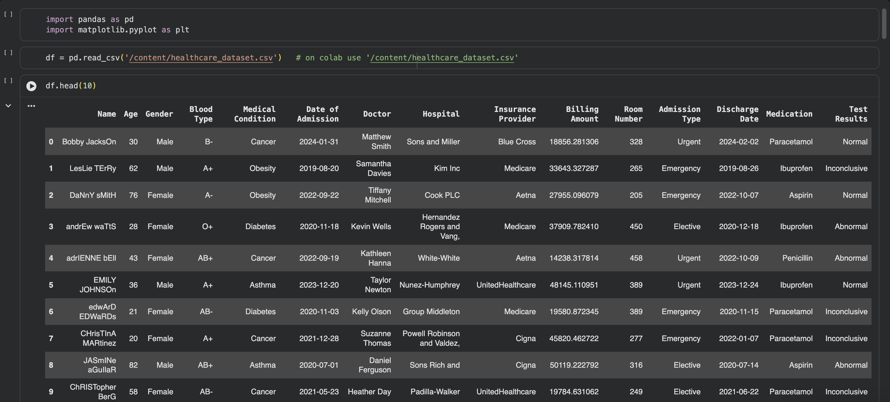

The raw data shows several quality issues straight away: patient names with random capitalization (for example `DaNnY sMitH`), and hospital names with stray words and commas (for example `Sons Rich and` and `Hernandez Rogers and Vang,`).

## Step 2: Data Cleaning

`df.info()` confirms 55,500 rows and 15 columns with no missing values. The two date columns are stored as text (`object`), so they need to be converted.

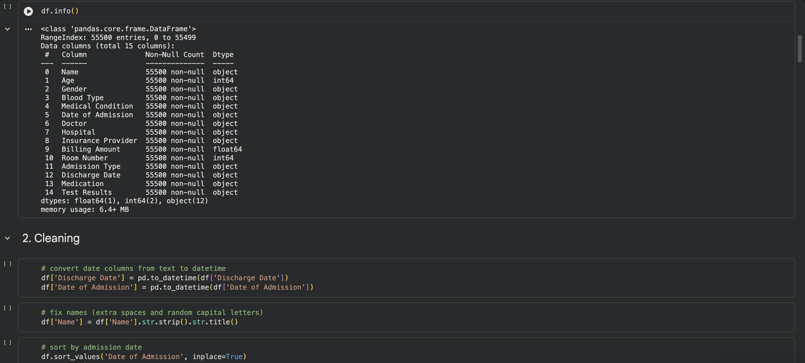

Cleaning steps applied in the notebook:

- Converted `Date of Admission` and `Discharge Date` to datetime
- Standardized patient names with `str.strip().str.title()`
- Sorted records by admission date
- Checked for missing values and duplicate rows

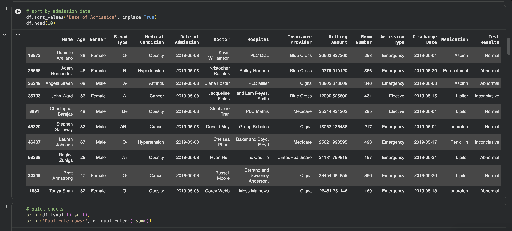

After cleaning, names such as `Bobby JacksOn` and `LesLie TErRy` appear in proper case, and records are ordered chronologically starting from 8 May 2019.

## Step 3: Feature Engineering

Three new columns were created for later analysis:

- `length_of_stay`: number of days between admission and discharge
- `admission_year`: year of admission
- `admission_month`: year and month of admission, used for the time series chart

```python
df['length_of_stay'] = (df['Discharge Date'] - df['Date of Admission']).dt.days
df['admission_year'] = df['Date of Admission'].dt.year
df['admission_month'] = df['Date of Admission'].dt.to_period('M')
```

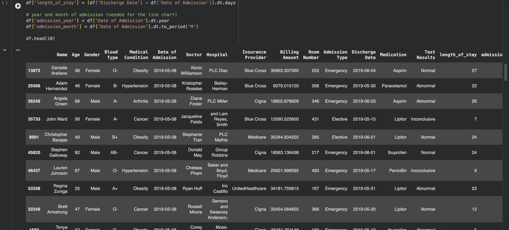

## Step 4: Exploration

The distinct values and counts of the main categorical columns were checked.

Insurance provider and medication:

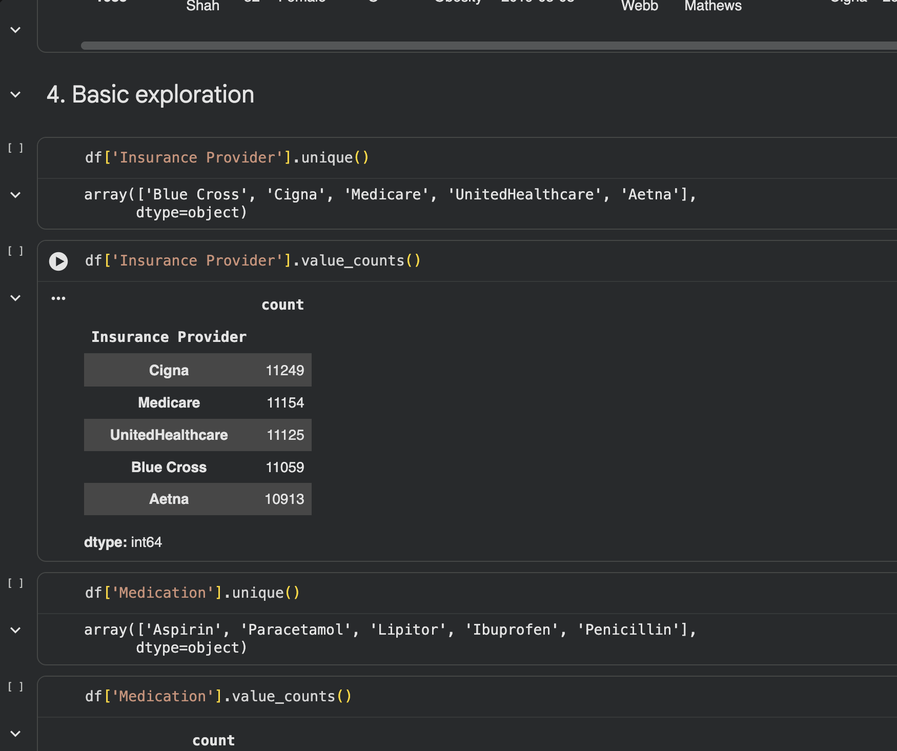

Medication, test results and admission type:

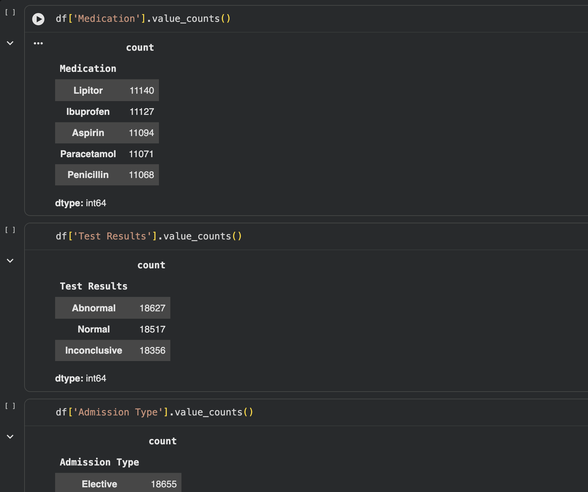

Blood type:

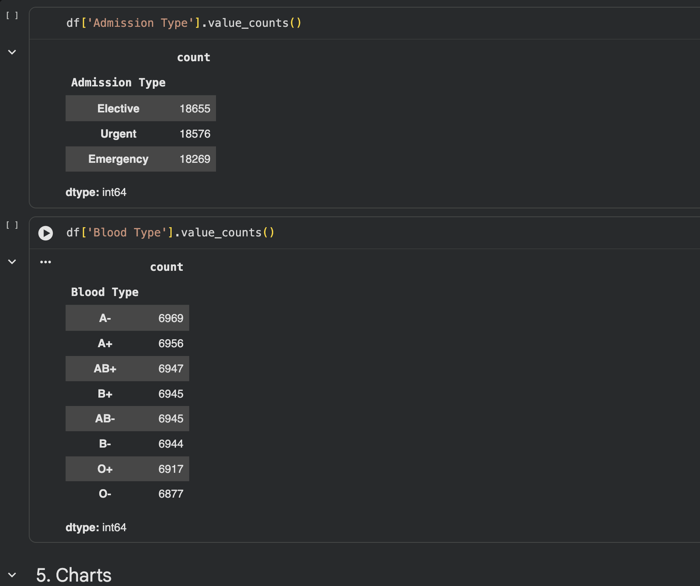

## Step 5: KPIs

Headline numbers calculated in the notebook on the loaded data (55,500 records, before duplicates are removed):

| KPI | Value |
|---|---|
| Total admissions | 55,500 |
| Total revenue | 1,417,432,043.40 |
| Average bill | 25,539.32 |
| Average length of stay | 15.5 days |

Note that these figures change slightly once the 534 duplicate rows and the negative billing amounts are handled (see the data quality notes below).

## Step 6: Visualizations

### Test results

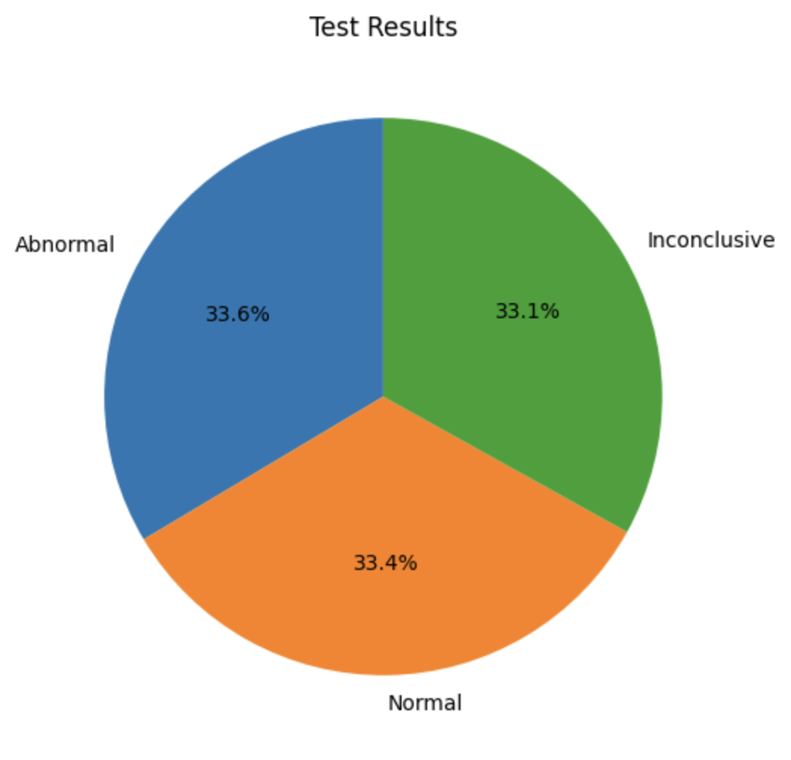

### Admission type

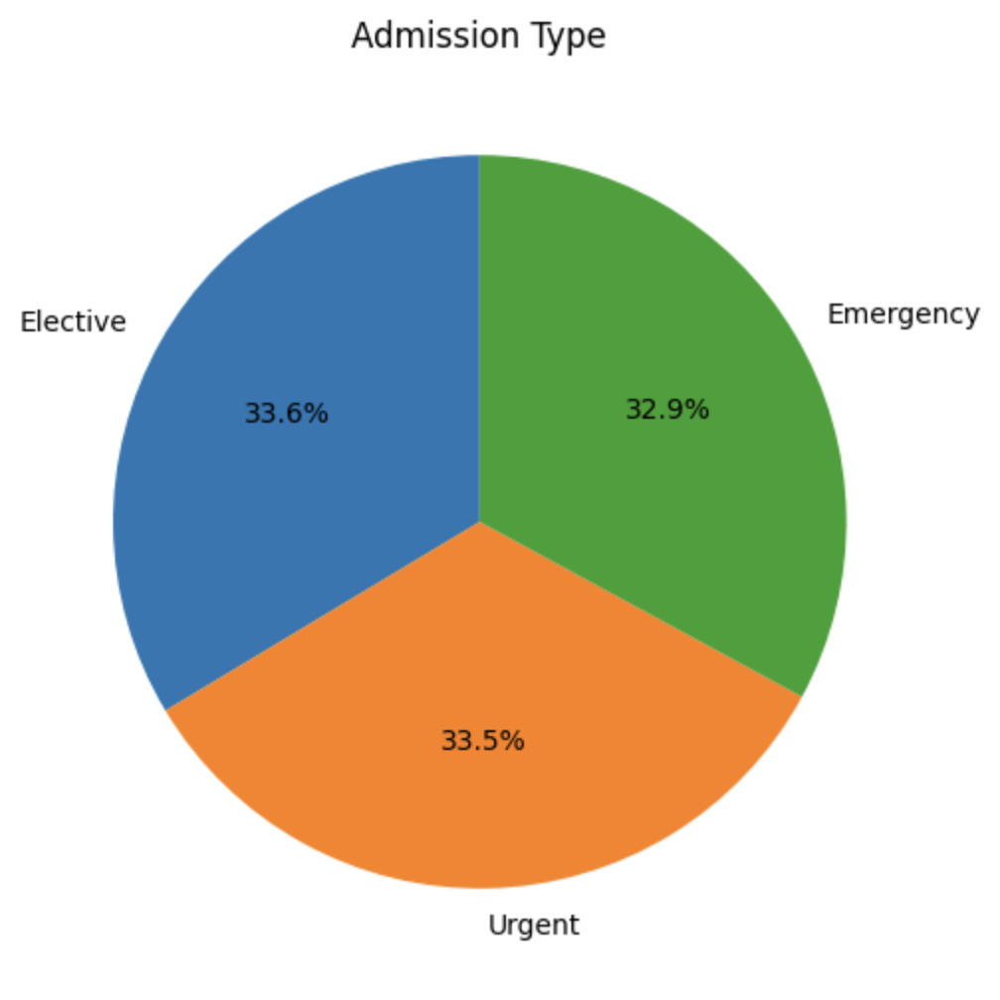

### Patients by blood type

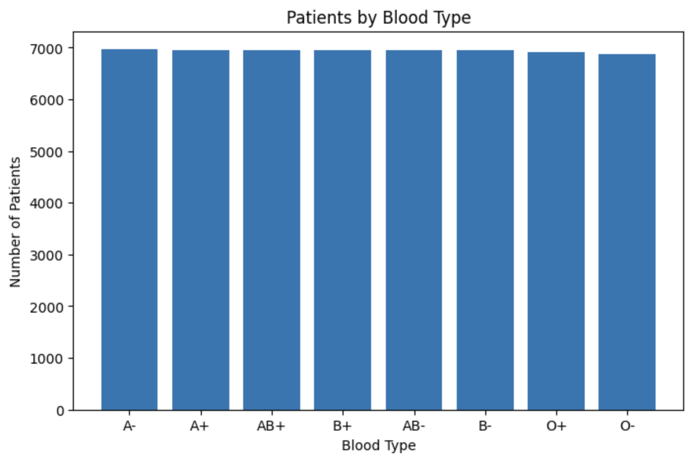

### Patients by insurance provider

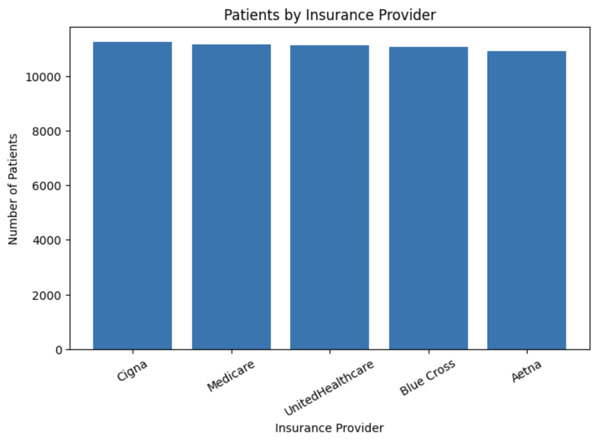

### Medication prescribed

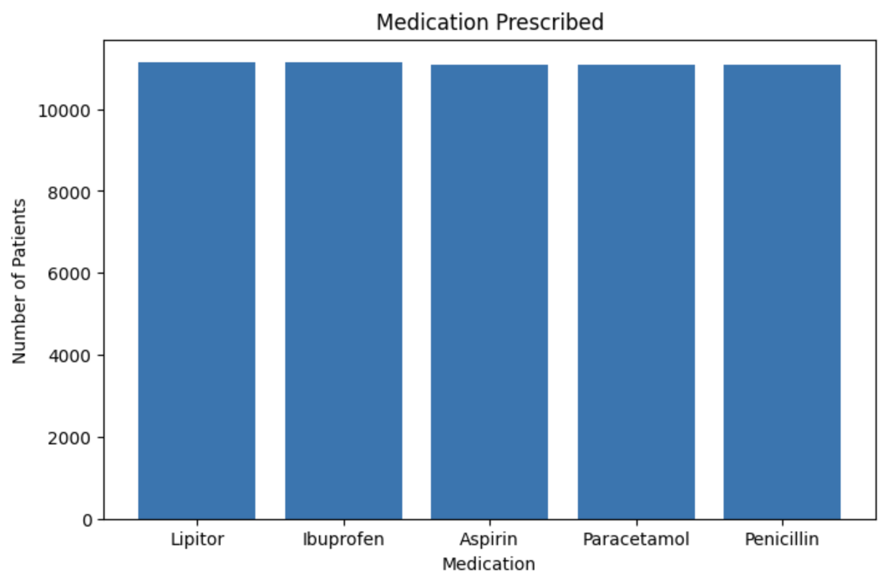

### Admissions per month

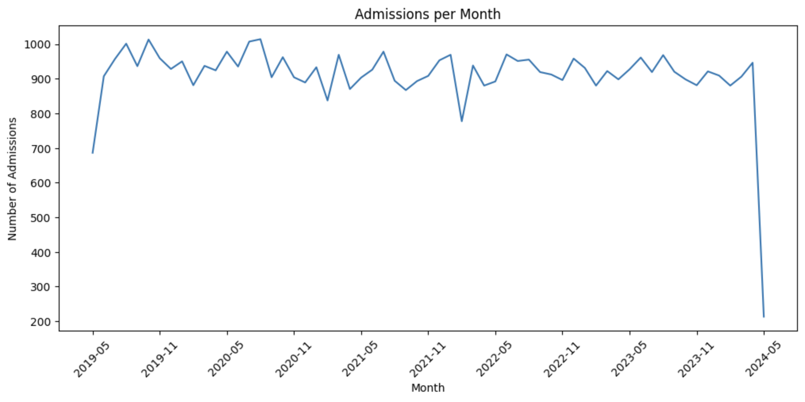

### Average bill by medical condition

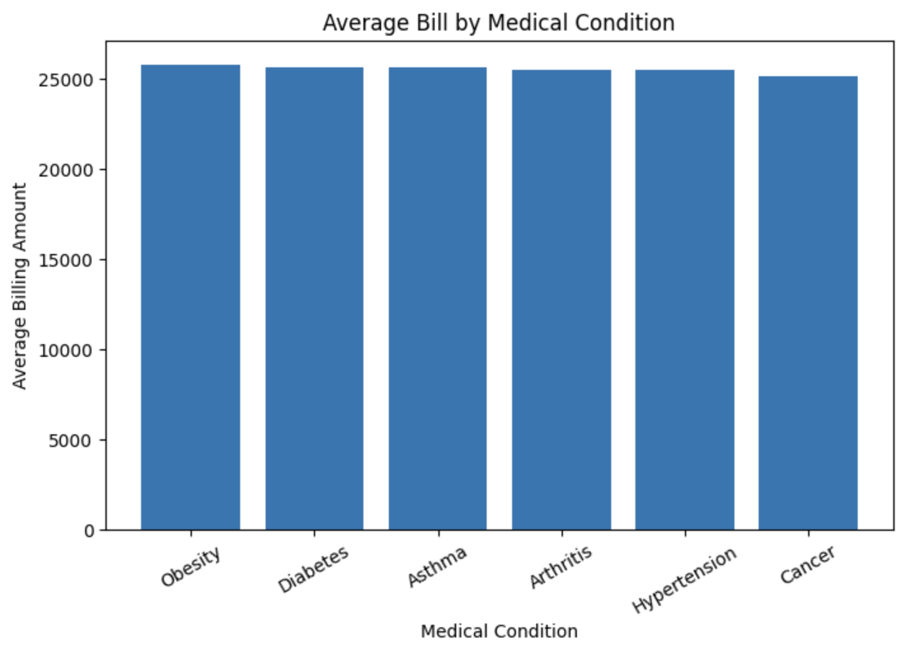

## Key Observations

- Test results are almost evenly split: Abnormal 33.6 percent, Normal 33.4 percent and Inconclusive 33.1 percent.
- Admission types are also nearly equal: Elective 33.6 percent, Urgent 33.5 percent and Emergency 32.9 percent.
- Each of the eight blood types accounts for roughly 6,900 to 7,000 patients.
- Insurance providers each cover between about 10,900 and 11,250 patients, with Cigna highest and Aetna lowest.
- The five medications are each used in about 11,100 admissions.
- The average bill is around 25,000 for every medical condition, with only small differences between them.
- Monthly admissions hover around 900 to 1,000 with no clear upward or downward trend.

## Limitations and Data Quality Notes

- The dataset appears to be synthetic. Categories are almost perfectly evenly distributed, so differences between groups are very small and should not be over-interpreted. This project is best read as a demonstration of the workflow rather than a source of real healthcare findings.
- The sharp drop at the end of the monthly admissions chart is not a real decline. May 2024 is a partial month, and May 2019 at the start is also incomplete. These two months should be excluded or filtered out in the SQL and Power BI stages.
- The dataset contains 534 exact duplicate rows. The notebook identifies them but does not remove them. They should be dropped before SQL and Power BI so that counts and revenue are not inflated (`df.drop_duplicates(inplace=True)`).
- Some billing amounts are negative (106 rows after removing duplicates). These are likely data entry errors and need a decision: take the absolute value, set them to null, or drop them.
- Some hospital names contain leftover words and commas from the source data (for example a trailing `and` or a trailing comma) and need cleaning if hospital is used in any analysis.
- Names are not unique identifiers. The dataset has no patient ID, so distinct patients cannot be counted reliably by name.

## Next Steps: SQL and Power BI

### SQL

Load `healthcare_cleaned.csv` into a database table and answer questions such as:

```sql
-- Average billing by medical condition
SELECT medical_condition, ROUND(AVG(billing_amount), 2) AS avg_bill
FROM healthcare
GROUP BY medical_condition
ORDER BY avg_bill DESC;

-- Admissions per year
SELECT admission_year, COUNT(*) AS admissions
FROM healthcare
GROUP BY admission_year
ORDER BY admission_year;

-- Average length of stay by admission type
SELECT admission_type, ROUND(AVG(length_of_stay), 1) AS avg_stay
FROM healthcare
GROUP BY admission_type;

-- Revenue by insurance provider
SELECT insurance_provider, SUM(billing_amount) AS revenue
FROM healthcare
GROUP BY insurance_provider
ORDER BY revenue DESC;
```

Column names above assume snake_case names (for example `medical_condition`). Rename the columns before loading if you use the original names with spaces.

### Power BI

A single-page dashboard is planned with:

- KPI cards: total admissions, total revenue, average bill, average length of stay
- Slicers: gender and medical condition or year
- Charts: admissions over time (line), test results and admission type (donut), insurance provider, medication and blood type (column), average bill by condition (column)

For the time chart, use a continuous axis, group by quarter or filter out the partial first and last months, and turn off data labels to avoid clutter.

## How to Run

1. Clone or download this repository.
2. Place `healthcare_dataset.csv` in the same folder as the notebook.
3. Install the requirements:
   ```
   pip install pandas matplotlib jupyter
   ```
4. Open `healthcare_analysis.ipynb` in Jupyter or Google Colab and choose Run All.
5. In Google Colab, upload the CSV and change the file path in the load cell to `/content/healthcare_dataset.csv`.

To run the plain script instead:

```
python analysis_charts.py
```

The script saves the cleaned file as `healthcare_cleaned.csv`.
